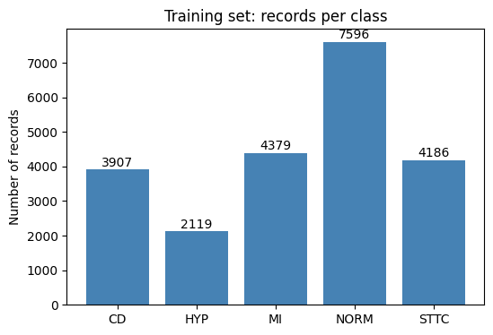
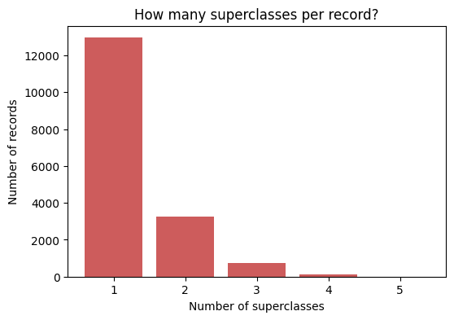
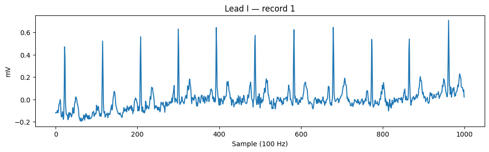
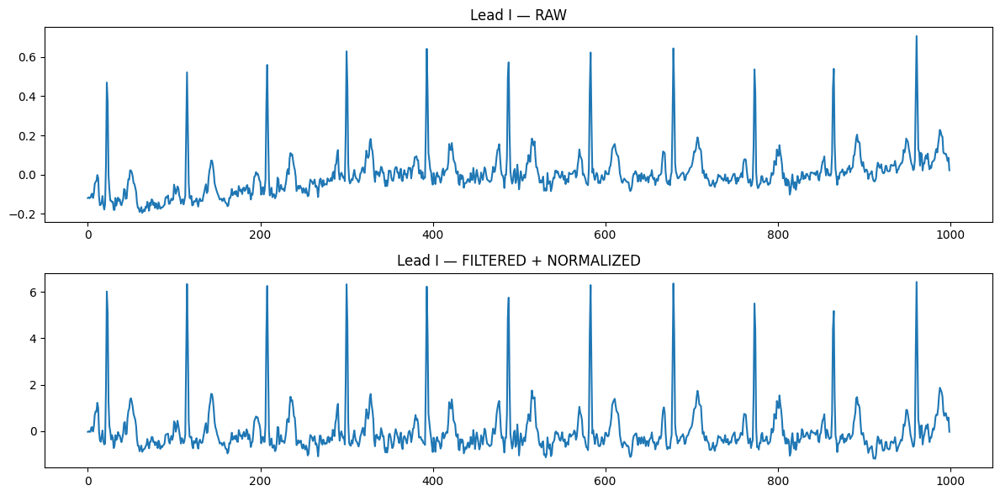
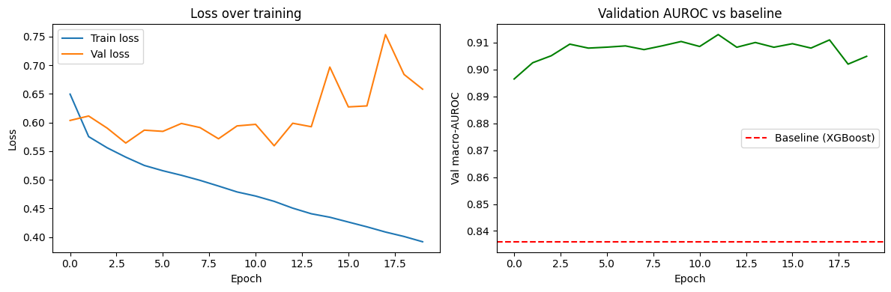
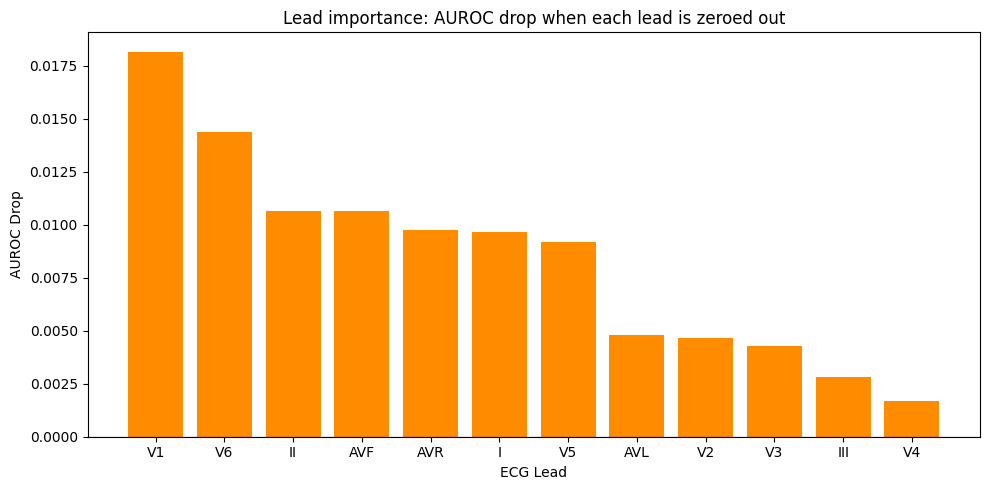

# Multi-Label Deep Learning for ECG Diagnosis: Which Leads Actually Matter?

A 1D convolutional neural network that reads raw 12-lead ECG signals and flags several heart conditions at the same time, plus a lead-ablation experiment that checks which of the 12 leads the model leans on most.

Built by Om Kadam (Cypress College) for undergraduate research conferences (SCCUR 2026 and NCUR 2027).

## Summary

- **Data:** PTB-XL, 21,388 clinical 12-lead ECGs (10 seconds each, 100 Hz), labeled with five diagnostic superclasses.
- **Task:** multi-label classification. About 24% of records carry more than one diagnosis, so each class is its own yes/no decision.
- **Models:** an XGBoost baseline on simple per-lead statistics and a 1D CNN on the raw waveform.
- **Result:** the CNN reached a test macro-AUROC of **0.910** and macro-F1 of **0.688**, against **0.834** and **0.539** for the baseline.
- **Interpretability:** zeroing out one lead at a time showed **V1 and V6** matter most to this model. The other leads were spread out below them.

| Model | Test macro-AUROC | Test macro-F1 |
|---|---|---|
| XGBoost baseline (72 summary features) | 0.834 | 0.539 |
| 1D CNN (raw signal) | **0.910** | **0.688** |

## Dataset

[PTB-XL](https://physionet.org/content/ptb-xl/1.0.3/) (Wagner et al., *Scientific Data*, 2020), downloaded from PhysioNet. Version 1.0.3, the 100 Hz recordings (`records100/`).

The 71 raw diagnostic codes are grouped into five superclasses using PTB-XL's own `scp_statements.csv`:

| Code | Meaning |
|---|---|
| NORM | normal ECG |
| MI | myocardial infarction |
| STTC | ST/T changes |
| CD | conduction disturbance |
| HYP | hypertrophy |

Records with no diagnostic superclass were dropped, leaving 21,388. The data is split with PTB-XL's official patient-stratified folds, so the same patient never lands in two splits: folds 1 to 8 for training (17,084), fold 9 for validation (2,146) and fold 10 for testing (2,158).

### Class balance and multi-label structure

NORM is the biggest class at 44.5% of training records and HYP is the smallest at 12.4%.



Almost a quarter of records have more than one label, which is why this is multi-label and not multi-class.



## Preprocessing

Each record goes through two steps and the result is cached to disk once.

1. **Bandpass filter, 0.5 to 40 Hz** (4th order Butterworth, zero-phase). This removes slow baseline drift and high-frequency noise.
2. **Per-lead z-score.** Each of the 12 leads is rescaled to mean 0 and standard deviation 1, so the model sees waveform shape instead of raw voltage.





## Models

### Baseline: XGBoost

Each lead is summarized with six numbers (mean, standard deviation, min, max, 25th and 75th percentile), giving 72 features per record. A `MultiOutputClassifier` trains five independent XGBoost models, one per class (200 trees, depth 4, learning rate 0.1). This is deliberately crude. It throws away the timing and shape of the heartbeat, so it is a simple reference point and not a tuned competitor.

### 1D CNN

Input is `(12 leads, 1000 samples)`. The network has four convolution blocks, then global average pooling, dropout and a linear layer. It outputs one raw score per class.

| Stage | Layer | Output shape |
|---|---|---|
| Input | | 12 x 1000 |
| Block 1 | Conv1d(12, 32, k=7) + BatchNorm + ReLU + MaxPool(2) | 32 x 500 |
| Block 2 | Conv1d(32, 64, k=5) + BatchNorm + ReLU + MaxPool(2) | 64 x 250 |
| Block 3 | Conv1d(64, 128, k=5) + BatchNorm + ReLU + MaxPool(2) | 128 x 125 |
| Block 4 | Conv1d(128, 256, k=3) + BatchNorm + ReLU + MaxPool(2) | 256 x 62 |
| Pooling | Global average pool | 256 |
| Head | Dropout(0.3) + Linear(256, 5) | 5 |

154,917 trainable parameters.

### Training

- **Loss:** `BCEWithLogitsLoss` (one independent yes/no per class) with `pos_weight = negatives / positives` per class to handle imbalance. The weights were CD 3.37, HYP 7.06, MI 2.90, NORM 1.25, STTC 3.08.
- **Optimizer:** Adam, learning rate 1e-3, batch size 64.
- **Checkpointing and early stopping:** validation macro-AUROC is checked every epoch. The best weights are saved, and training stops after 8 epochs with no improvement. In the notebook run it stopped at epoch 20 and the best checkpoint was epoch 12 (validation AUROC 0.9129), after about a minute on a Colab GPU.

Validation loss gets noisy and drifts up while training loss keeps falling, which is overfitting. That is why the best checkpoint is kept and not the last epoch.



## Results

Test fold, best checkpoint, decision threshold 0.5 for F1.

| | Macro-AUROC | Macro-F1 |
|---|---|---|
| XGBoost baseline | 0.834 | 0.539 |
| 1D CNN | 0.910 | 0.688 |

Per-class test AUROC for the CNN:

| CD | HYP | MI | NORM | STTC |
|---|---|---|---|---|
| 0.914 | 0.836 | 0.926 | 0.942 | 0.933 |

HYP is the weakest class even though it got the largest loss weight (7.06). It was also the weakest class for the baseline on the validation fold (AUROC 0.736). It is the rarest class, which may be part of the reason, but this project did not test that directly, so class weighting alone clearly did not close the gap.

F1 sits well below AUROC because F1 uses a fixed 0.5 cutoff for every class, which is not ideal for the rarer ones. Per-class threshold tuning was not done.

## Lead ablation

For each lead in turn, that lead's values are set to zero for every test record and the macro-AUROC is recomputed. A bigger drop means the model relies on that lead more. Full model AUROC is 0.9102.



| Rank | Lead | AUROC after zeroing | Drop |
|---|---|---|---|
| 1 | V1 | 0.8920 | 0.0182 |
| 2 | V6 | 0.8958 | 0.0144 |
| 3 | II | 0.8995 | 0.0107 |
| 4 | AVF | 0.8995 | 0.0106 |
| 5 | AVR | 0.9004 | 0.0098 |
| 6 | I | 0.9005 | 0.0097 |
| 7 | V5 | 0.9010 | 0.0092 |
| 8 | AVL | 0.9054 | 0.0048 |
| 9 | V2 | 0.9055 | 0.0047 |
| 10 | V3 | 0.9059 | 0.0043 |
| 11 | III | 0.9074 | 0.0028 |
| 12 | V4 | 0.9085 | 0.0017 |

What this does and does not show:

- V1 and V6 stand out. II, AVF, AVR, I and V5 form a middle group (about 0.009 to 0.011). AVL, V2, V3, III and V4 matter least.
- The chest leads do **not** rank together. V1 and V6 are at the top but V2, V3 and V4 are near the bottom, so "precordial leads matter most" would be too strong a claim.
- Every lead had a positive drop, so the model uses all 12 to some degree.
- The drops are small (largest is 0.018 on a 0.910 base). This is one trained model from one run, with no confidence intervals, so treat the ranking as suggestive.
- Zeroing a lead gives the network an input it never saw in training, and correlated leads can partly cover for each other. The ranking says what this model relies on, not which lead is clinically most useful.

## Limitations

- One dataset, no external validation. A second dataset such as Chapman-Shaoxing was planned as a stretch goal and was not done.
- One training run per model. The notebook did not set a random seed, so rerunning will move the numbers slightly. The scripts in `src/` set a seed (42) by default.
- The validation fold chose the checkpoint and stopping point. Only the test fold was left untouched until the end.
- The baseline uses only six statistics per lead, so part of the CNN's advantage reflects how simple that baseline is.
- Labels are PTB-XL's superclass groupings. This is a research project, not a clinical tool.

## Repository layout

```
src/
  data.py          label mapping, bandpass filter, normalization, cache builder, official fold split
  baseline.py      XGBoost baseline on 72 summary features
  model.py         ECGDataset and the 1D CNN
  train.py         weighted-loss training with checkpointing and early stopping
  evaluate.py      test-fold metrics for the best checkpoint
  lead_ablation.py zero-one-lead-at-a-time experiment and chart
notebooks/
  ecg_colab_notebook.ipynb   the original Colab notebook with all outputs
figures/                     plots used in this README (from the notebook run)
results/
  final_results.json         metrics from the notebook run
```

## Reproduce

```bash
pip install -r requirements.txt

# 1. get PTB-XL 1.0.3 from PhysioNet into ./data so that these exist:
#    data/ptbxl_database.csv, data/scp_statements.csv, data/records100/
#    (the zip from https://physionet.org/content/ptb-xl/1.0.3/ is fastest, recursive wget is slow)

python -m src.data          # filter + normalize every record once, caches X, Y and folds in ./data
python -m src.baseline      # XGBoost baseline
python -m src.train         # train the CNN, saves outputs/best_model.pt
python -m src.evaluate      # test-fold metrics
python -m src.lead_ablation # lead importance chart
```

The figures and `results/final_results.json` in this repo come from the notebook run. The scripts write fresh outputs to `outputs/` (git-ignored), so running them will not overwrite the notebook results.

## Credits

Data: Wagner, P., Strodthoff, N., Bousseljot, R.-D., et al. *PTB-XL, a large publicly available electrocardiography dataset.* Scientific Data 7, 154 (2020). Hosted on PhysioNet.
